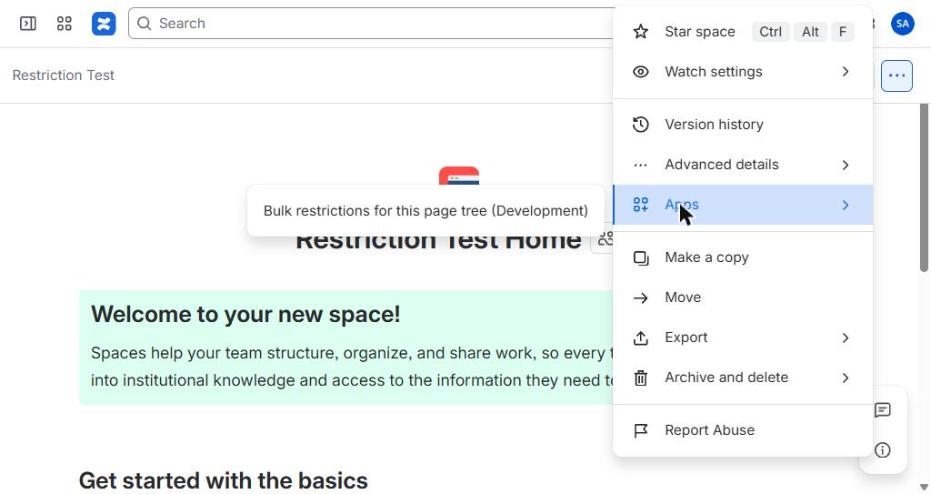
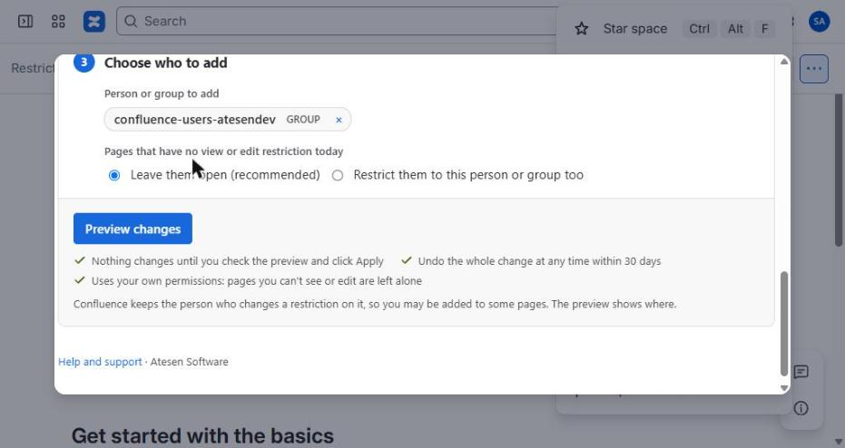
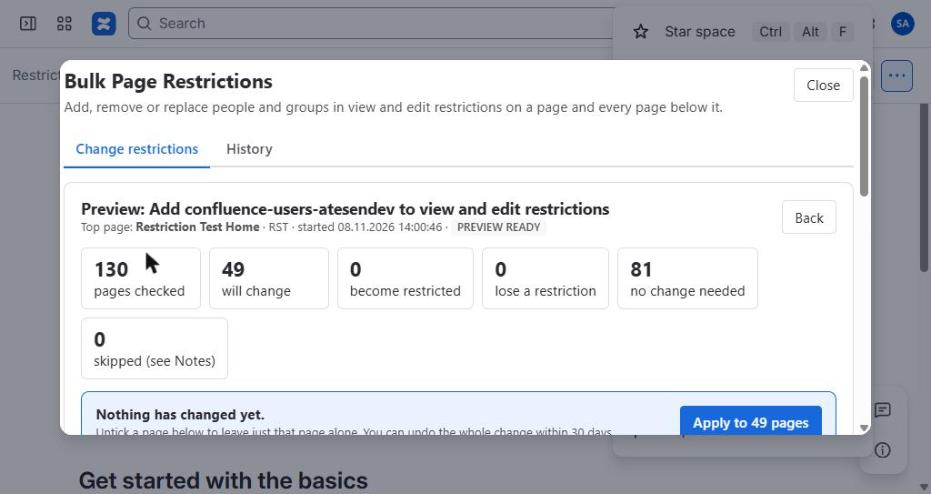
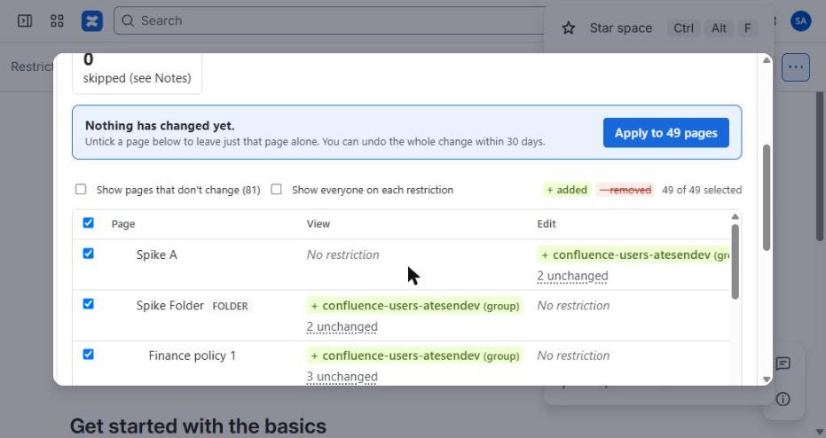

# Your first preview in 60 seconds

Nothing changes until you click Apply. You can undo any change within 30 days.

## 1. Open it from a page

Page **•••** menu → **Apps** → **Bulk restrictions for this page tree**. This page is the top page.

## 2. Pick who to add

Scroll to step 3, type a name or group, and select it.

## 3. Click Preview changes

You see how many pages would change. Nothing has changed yet.

## 4. Check the table

Added names are green, removed names are struck through. Untick any page you want to leave alone.

Happy with it? Click **Apply**. Not sure? Close the window, nothing was changed.

[Full user guide](guide.html)
