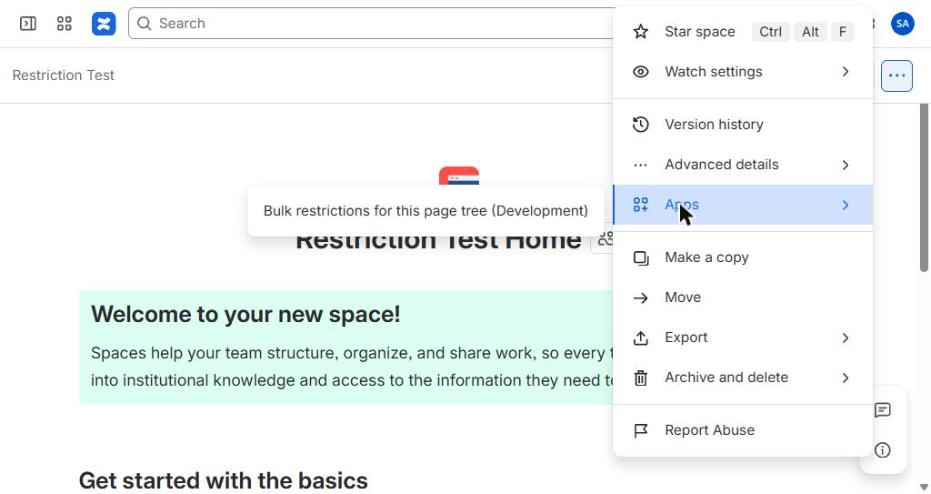
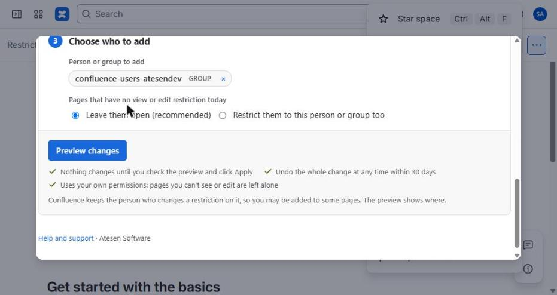
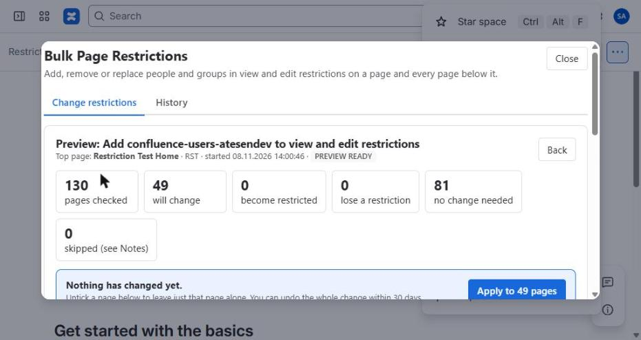
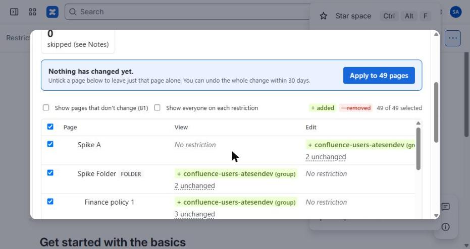

# Run your first bulk restriction change in Confluence

Start with a small test tree where you can edit restrictions. For this example, choose a tree with an existing edit restriction and a test group that should be allowed to edit. Preview is read-only. Applying a change requires an active app licence.

## 1. Open it from a page

Page **•••** menu → **Apps** → **Bulk restrictions for this page tree**. The page you open it from is the top of the tree.

## 2. Choose the group to add

Choose **Add someone** and **Edit only**. Under **Choose who to add**, search for your test group and select it. Keep **Leave them open (recommended)** selected so pages without an edit restriction stay open.

## 3. Preview and select pages

Click **Preview changes**. Check the number of pages scanned and the number that would change. Read the before and after restrictions in the table, then untick any page you want to leave alone.

If the preview shows no changes, check whether your group is already listed or the pages lack an edit restriction. Choose an already restricted test page where the group is absent and preview again.

## 4. Apply and check the result

1. Click **Apply to N pages** above the table. Check the count in the confirmation, then choose **Yes, change N pages**.
2. Keep the window open and wait for **Done**. The **Result** column explains skips, including pages whose restrictions changed after the preview. Select **Download CSV report** to keep a record.
3. Check an applied page in Confluence. For a rehearsal, open the completed change or find it in **History** and select **Undo this change** within 30 days. If someone changed a page's restrictions after your run, undo leaves that page alone and reports it.

## 5. Review the trial with your billing admin

Share the number of pages that changed and any skips you still need to review. Use the [Marketplace Pricing tab](https://marketplace.atlassian.com/apps/350305877/bulk-page-restrictions-for-confluence?tab=pricing) to check the price for your Confluence site's user tier.

In Atlassian's improved billing experience, your billing admin can open [Atlassian Billing](https://admin.atlassian.com/billing) and select the relevant billing account. Under **Subscriptions**, choose **Manage** next to Bulk Page Restrictions for the site you tested. Check the trial end date, billing amount and payment method. For the original billing view, see [Atlassian's purchasing and licensing guide](https://www.atlassian.com/licensing/purchase-licensing).

With a valid payment method, a monthly Marketplace app trial can convert to a paid subscription when it ends. If you decide to end the trial, use [Atlassian's deactivation instructions](https://support.atlassian.com/subscriptions-and-billing/docs/cancel-a-subscription/) before the trial end date. For annual billing, arrange a quote and purchase through Atlassian.

[Full user guide](guide.html) · [Get setup help](support.html)
